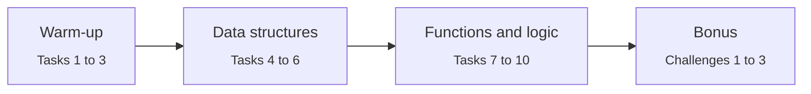

<div align="center">

# Lab 01 · Introduction to Python Programming

**CS-3105 · Machine Learning Lab**


*Variables, strings, nested data, functions and logic, the foundation every later lab builds on.*

</div>

<br>

| | |
|---|---|
| **Student** | [Shahzad Ahmed Awan](https://github.com/ShahzadAhmedAwan) |
| **Roll No** | 2024-SE-15 |
| **Instructor** | Engr. Muhammad Awais |
| **Tool** | Python 3.9+ in Jupyter Notebook or Google Colab |
| **Libraries** | None, standard library only |

---

## Learning outcome

> **CLO 5:** Use Python programming and tools to perform data handling and basic operations.
> **Domain:** Cognitive, C-3 (Application) · **PLO 5:** Modern Tool Usage

By the end of this lab you can:

- Perform arithmetic and string formatting in Python
- Index into nested lists and dictionaries
- Explain the difference between a list and a tuple
- Write functions using conditionals, string methods and loops to solve short logic problems

## Lab flow



## Tasks

Each task has a text cell (question, approach, expected result) followed by one code cell. Every output is labelled `Q1:`, `Q2:` and so on.

| # | Task | Concept |
|:-:|---|---|
| 1 | Compute 7 to the power of 4 | `**` operator |
| 2 | Split `"Hi there Sam!"` into a list | `str.split()` |
| 3 | Print *The diameter of Earth is 12742 kilometers.* | `str.format()` |
| 4 | Grab `'hello'` from a nested list | Nested list indexing |
| 5 | Grab `'hello'` from a nested dictionary | Dict keys and list positions |
| 6 | Tuple vs list | Mutability, `TypeError` demo |
| 7 | `get_domain()` returns the domain of an email | `split("@")` |
| 8 | `find_dog()` checks for "dog", case-insensitive | `lower()`, `in` |
| 9 | `count_dog()` counts "dog", case-insensitive | `lower()`, `count()` |
| 10 | `caught_speeding(speed, is_birthday)` | Conditionals, edge cases |

### Bonus challenges

| # | Challenge | Approach |
|:-:|---|---|
| 1 | Count `dog` with trailing punctuation | Split into words, strip punctuation, whole-word match |
| 2 | `is_palindrome(word)` | Slicing with `word[::-1]` |
| 3 | Top student from a list of five dicts | Loop and compare marks |

## Sample output

```text
Q1: 7 to the power of 4 = 2401
Q2: ['Hi', 'there', 'Sam!']
Q3: The diameter of Earth is 12742 kilometers.
Q4: hello
Q5: hello
Q7: domain.com
Q9: 2
Q10: speed = 86 | birthday = True -> Big Ticket
Bonus 1: 4
Bonus 3: Sara with 97 marks
```

## Getting started

<details open>
<summary><b>Google Colab</b> (recommended, nothing to install)</summary>

<br>

1. Open [colab.research.google.com](https://colab.research.google.com) and sign in.
2. Choose **File → Upload notebook** and select the `.ipynb` file.
3. Run **Runtime → Restart and run all**.

</details>

<details>
<summary><b>Run locally</b></summary>

<br>

```bash
pip install notebook
jupyter notebook Lab01_2024-SE-15_ShahzadAhmedAwan.ipynb
```

Then choose **Kernel → Restart & Run All**.

</details>

## Repository structure

```text
.
├── Lab01_2024-SE-15_ShahzadAhmedAwan.ipynb   # solutions: 10 tasks + 3 bonuses
├── ML_Lab01_FINAL.html                       # instructor's lab manual and slides
└── README.md
```


Four criteria, each scored 0 to 4, for a total of **16 marks**.

| Criterion | Excellent (4) looks like |
|---|---|
| **Correctness of solutions** | All 10 tasks correct, including nested indexing and the birthday edge case |
| **Use of core Python constructs** | Confident use of variables, conditionals, loops, functions and built-in methods |
| **Code quality and readability** | Clean, well-organised code with meaningful names and useful comments |
| **Environment setup and execution** | Notebook runs top to bottom without errors, all outputs visible |


## Notes

- **Task 6** includes a live demo: the list changes successfully, while the tuple raises a `TypeError`.
- **Task 10** applies the birthday rule through a single `allowance` variable, so the logic is written once. Boundary values (60/61/80/81 and 65/66/85/86) are all tested.
- **Bonus 1** matches whole words only, so `hotdog` is not counted. The plain `count_dog()` from Task 9 counts substrings and would count it.

---

<div align="center">

**Shahzad Ahmed Awan** ·
[GitHub: @ShahzadAhmedAwan](https://github.com/ShahzadAhmedAwan)

</div>
