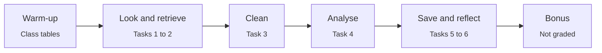
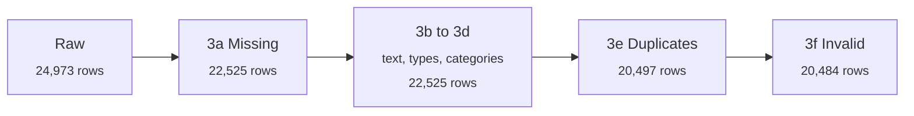

# Lab 03 · Pandas for Data Manipulation and Cleaning

### CS-3105 · Machine Learning Lab

*Implementation documentation: approach, function signatures and observations for every task.*

 

 

| 6 | 30 | 3 | 0 | 30+ |
|:---:|:---:|:---:|:---:|:---:|
| **Tasks** | **Parts** | **Datasets** | **Row loops** | **Functions documented** |

 

## 👤 Submission details

| Field | Detail |
|:--|:--|
| **Student** | [Shahzad Ahmed Awan](https://github.com/ShahzadAhmedAwan) |
| **Roll No** | 2024-SE-15 |
| **Instructor** | Engr. Muhammad Awais |
| **Course** | CS-3105 Machine Learning Lab, Lab 03 |
| **Outcome** | CLO 6 · Cognitive C-4 (Analyze) · PLO 2 Problem Analysis |
| **Environment** | Python 3.9+ in Jupyter or Google Colab |
| **Libraries** | `pandas` (all tasks), `numpy` (only `np.nan`) |
| **Recorded with** | pandas 3.x (outputs show the new `str` dtype), Python 3.12 |

---

## 📑 Contents

| # | Section | # | Section |
|:-:|:--|:-:|:--|
| 1 | [Overview and workflow](#-overview-and-workflow) | 9 | [Task 4 · Analyse](#-task-4--analyse) |
| 2 | [Datasets](#-datasets) | 10 | [Tasks 5 and 6](#-task-5--save-your-work) |
| 3 | [Lab at a glance](#-lab-at-a-glance) | 11 | [Bonus](#-bonus-not-graded) |
| 4 | [Warm-up · Class tables](#-warm-up--class-tables-not-graded) | 12 | [Function reference](#-function-reference) |
| 5 | [Task 1 · First look](#-task-1--load-and-first-look) | 13 | [Syntax cheat sheet](#-syntax-cheat-sheet) |
| 6 | [Task 2 · Retrieve](#-task-2--retrieve-data) | 14 | [Key learnings](#-key-learnings) |
| 7 | [Task 3 · Cleaning](#-task-3--cleaning-the-six-types-of-dirty-data) | 15 | [Pitfalls](#-common-pitfalls) |
| 8 | [Cleaning funnel](#-the-cleaning-funnel) | 16 | [Running the notebook](#-running-the-notebook) |

---

## 🗺️ Overview and workflow

| Phase | Tasks | Parts | Focus |
|:--|:-:|:-:|:--|
| Warm-up | n/a | 5 (not graded) | Masks, `loc` vs `iloc`, detecting dirt on an 8-student table |
| Look and retrieve | 1 to 2 | 13 | Shape, dtypes, columns, rows, cells, filters, sorting |
| Clean | 3 | 7 | All six types of dirty data, fixed in the prescribed order |
| Analyse | 4 | 8 | New columns, counting, `groupby`, depreciation, outliers |
| Save and reflect | 5 to 6 | 2 | Clean CSV for Lab 04 and a written reflection |

**Working rules followed throughout**

| Rule | How it is applied |
|:--|:--|
| No loops over rows | Every task uses `.str`, `astype`, `replace`, masks, `groupby` or `nlargest` |
| Labelled output | Each print starts with its task ID, for example `T4e:` |
| Clean in order | Missing → formatting → types → categories → duplicates → invalid values |
| Assign back | `df = df.drop_duplicates()`, never a bare call |
| Starter data | The raw CSV is read once and never edited by hand |
| Words in Markdown | Task answers sit in Markdown cells, not inside code cells |
| Run top to bottom | Saved after Restart and Run All, with a self-check `assert` |

---

## 📊 Datasets

| Dataset | Variables | Shape | Content | Source |
|:--|:--|:-:|:--|:--|
| 🚗 Raw car ads | `Brand`, `Condition`, `Fuel`, `KMs Driven`, `Model`, `Price`, `Registered City`, `Transaction Type`, `Year` | (24,973, 9) | Used and new car ads with dirty data | OLX Pakistan, Open Data Pakistan 2021 (practice copy) |
| ✨ Clean car ads | The 9 columns plus `Price_lakh` and `Age` | (20,484, 9) after Task 3, (20,484, 11) saved | Output of Tasks 3 to 5, used by Lab 04 | Derived |
| 🏫 Class tables | `clean` and `messy` with `Roll`, `Name`, `City`, `Maths`, `Physics`, `Attendance` | (8, 6) and (9, 6) | Warm-up tables with the six kinds of dirt | Lecture example |

**Column types before and after cleaning**

| Column | Raw type | Clean type | Meaning |
|:--|:-:|:-:|:--|
| `Brand`, `Condition`, `Fuel`, `Model` | text | text | Car description |
| `Registered City`, `Transaction Type` | text | text | Where registered, Cash or Installment/Leasing |
| `KMs Driven` | float64 | float64 | Kilometres driven, impossible values set to NaN |
| `Price` | **text** | **int64** | Asking price in rupees |
| `Year` | **float64** | **Int64** | Model year (capital `I` allows missing values) |
| `Price_lakh` | n/a | float64 | `Price / 100,000` |
| `Age` | n/a | Int64 | `2020 - Year` |

---

## 🧭 Lab at a glance

| Task | Topic | Core technique | Main signature | Headline result |
|:-:|:--|:--|:--|:--|
| W | Warm-up | Masks and `drop_duplicates` | `df[df["col"] > value]` | Mean Maths 117.75 on messy vs true 70.0 |
| 1 | First look | Inspect dtypes | `df.dtypes` | `Price` is text, 750 ads contain `Rs` |
| 2 | Retrieve | `loc`, `iloc`, masks | `df.loc[row, col]` | 986 Islamabad ads, 202 Honda hybrids |
| 3 | Clean | Six-step pipeline | `df.drop_duplicates()` | Shape (20484, 9) |
| 4 | Analyse | `groupby` and `nlargest` | `df.groupby(col)[col].median()` | Corolla GLI loses 1.37 lakh per year |
| 5 | Save | CSV export | `df.to_csv(path, index=False)` | (20,484, 11) saved and re-checked |
| 6 | Reflection | Written findings | n/a | Invalid values inflated mean KMs by 41 % |

---

## ✅ Warm-up · Class tables (not graded)

| Input | Technique | Output |
|:--|:--|:--|
| `clean` (8 students) and `messy` (9 rows, six kinds of dirt) | Masks, `loc` vs `iloc`, detection | Five checks before touching the cars |

| Part | Goal | Approach | Function signature | Result |
|:-:|:--|:--|:--|:--|
| W1 | Students with Maths above 80 | One boolean mask | `df[df["Maths"] > 80]` | Ayesha, Fatima, Zainab |
| W2 | Muzaffarabad and Maths above 80 | Two masks, brackets, `&` | `df[(c1) & (c2)]` | Fatima, Zainab |
| W3 | `loc` vs `iloc` end point | Slice both | `df.loc[0:2]` · `df.iloc[0:2]` | 3 rows vs 2 rows |
| W4 | Detect problems in `messy` | Count NaN, duplicates, mean | `df.isna().sum()` · `df.duplicated().sum()` | 1 missing, 1 duplicate, mean Maths 117.75 (true 70.0) |
| W5 | Silent trap | Call without assigning, then assign | `df = df.drop_duplicates()` | 9 rows unchanged, then 8 |

**Observation:** one typo (380 instead of 38) and one duplicate pushed the class mean to 117.75 out of 100 with no error message. That is why cleaning comes before analysis.

---

## ✅ Task 1 · Load and first look

| Input | Technique | Output |
|:--|:--|:--|
| `pakistan_used_cars.csv` | Load and inspect | Shape, head, columns, dtypes, the text column |

| Part | Goal | Approach | Function signature | Result |
|:-:|:--|:--|:--|:--|
| a | Load and print shape | Read the CSV into `df` | `pd.read_csv(filepath)` · `df.shape` | (24,973, 9) |
| b | First 5 rows | Preview | `df.head(n=5)` | Prado, Bolan, Alto, Corolla XLI rows |
| c | Column names | Convert the index to a list | `list(df.columns)` | 9 names |
| d | Data type of every column | Read dtypes | `df.dtypes` | 7 text, 2 float64 |
| e | Number stored as text | Mask on `"Rs"`, show two values | `Series.str.contains(pat)` | `Price`, e.g. `Rs 435,000` and `Rs 4,150,000` |

**Observations**

| Point | Finding |
|:--|:--|
| Why `Price` is text | 750 ads write the price as `Rs 435,000`, while the rest are plain digits like `2100000` |
| One value is enough | A single text value makes pandas keep the whole column as text |
| `Year` is float | Missing values force `1997.0` instead of `1997` (fixed with `Int64` in Task 3c) |

---

## ✅ Task 2 · Retrieve data

| Input | Technique | Output |
|:--|:--|:--|
| Raw `df` | Column, row, cell selection, masks, sorting | Eight retrievals and one expected error |

| Part | Goal | Approach | Function signature | Result |
|:-:|:--|:--|:--|:--|
| a | `Brand`, first 5 | One column gives a Series | `df["Brand"].head()` | Toyota, Suzuki, Suzuki, Suzuki, Toyota |
| b | `Brand`, `Model`, `Price` | List inside brackets | `df[["Brand", "Model", "Price"]]` | 5 × 3 table |
| c | First row | Position based | `df.iloc[0]` | Toyota Prado, 1997 |
| d | `Model` of index 100 | Label based | `df.loc[100, "Model"]` | Mehran VX |
| e | Cars in Islamabad | Exact match, then after strip and title | `(df["Registered City"] == "Islamabad").sum()` | **986** (exact match finds 958) |
| f | Honda hybrids | Two masks with `&` | `((c1) & (c2)).sum()` | 202 |
| g | 2018 or newer, newest first | Filter, then stable sort | `df.sort_values("Year", ascending=False, kind="mergesort")` | Probox and Fit (2020) first |
| h | `Price > 1_000_000` | Expect an error, catch it | `try` / `except TypeError` | `TypeError`, text vs int |

**Why 958 and 986 differ**

| Raw spelling | Ads |
|:--|:-:|
| `'Islamabad'` | 958 |
| `'  Islamabad'` | 7 |
| `' islamabad '` | 6 |
| `'Islamabad  '` | 6 |
| `'islamabad'` | 5 |
| `'ISLAMABAD'` | 4 |

**Observations**

| Point | Finding |
|:--|:--|
| Hidden spellings | 28 ads are missed by an exact match, which is why Task 3b matters |
| After cleaning | 777 Islamabad ads remain once duplicates are removed (see Task 4d) |
| 2g tie order | `kind="mergesort"` keeps cars with the same year in their original order, so the top 10 is identical on every run |
| 2h cause | `Price` is still text, and pandas cannot compare a string with a number. The same filter works after Task 3c (6,843 ads above 1,000,000) |

---

## ✅ Task 3 · Cleaning the six types of dirty data

| Input | Technique | Output |
|:--|:--|:--|
| Raw `df` (24,973 × 9) | Detect, then fix, in the prescribed order | Clean `df` (20,484 × 9) |

| Part | Type | Approach | Function signature | Result |
|:-:|:--|:--|:--|:--|
| a | 1 · Missing values | Count NaN per column, drop ads with no `Brand` or `Model`, fill three text columns with `"Unknown"`, leave `Year` and `KMs Driven` as NaN | `df.dropna(subset=cols)` · `df.fillna(value_dict)` | 2,448 rows removed, 22,525 left |
| b | 2 · Formatting | Strip spaces and fix case in city names, remove `Rs` and commas from `Price` | `Series.str.strip()` · `.str.title()` · `.str.replace(pat, repl, regex=False)` | City spellings 106 → 62, 681 `Rs` prices cleaned |
| c | 3 · Data types | `Price` to `int64`, `Year` to `Int64` | `Series.astype(dtype)` | `str` → `int64`, `float64` → `Int64` |
| d | 4 · Inconsistent categories | `Sukkar` → `Sukkur`, `Corrolla Altis` → `Corolla Altis` | `Series.replace({old: new})` | 3 and 339 ads fixed, cities 62 → 61 |
| e | 5 · Duplicates | Count, drop, assign back | `df.duplicated()` · `df.drop_duplicates()` | 2,028 duplicates, 20,497 rows |
| f | 6 · Invalid values | Impossible KMs to NaN, drop fake prices and Suzuki/Daihatsu above 5,000,000 | `df.loc[mask, col] = np.nan` · `Series.isin(values)` | 2,852 KMs set to NaN, 13 rows dropped |
| g | Self-check | Compare shape with the required value | `assert df.shape == (20484, 9)` | Passes |

**Rules used in 3f**

| Column | Rule | Action |
|:--|:--|:--|
| `KMs Driven` | below 100, above 1,000,000, or exactly 12345 or 123456 | Set to NaN, keep the ad |
| `Price` | exactly 12,345,678 or 87,654,321 | Drop the ad (3 ads) |
| `Price` | above 5,000,000 for Suzuki or Daihatsu | Drop the ad (12 ads, 2 overlap with the fake prices, so 13 rows in total) |

**Observations**

| Point | Finding |
|:--|:--|
| Order matters | Text is cleaned before duplicates, so `KARACHI` and `Karachi` ads cannot hide from `drop_duplicates()` |
| Missing values | After the drop no column had NaN left, so the missing `Year` and `KMs Driven` values were in the same 2,448 ads |
| Effect of invalid KMs | Mean `KMs Driven` fell from 131,160 to 93,238, so it was about 41 % too high |
| Invalid vs outlier | Impossible values are fixed or dropped by a rule, unusual but possible prices are only flagged (Task 4g) |
| Late duplicates | 128 ads became identical only after Type 6 set their wrong KMs to NaN. They are counted but kept, because the self-check requires (20484, 9). Without them the table would have 20,356 rows |
| Cleaning log | A summary table is built from computed variables, so every number in it comes from the cells above |

---

## 🧮 The cleaning funnel

| Step | Rows after | Change | What changed |
|:--|--:|--:|:--|
| Raw file | 24,973 | n/a | 9 columns |
| 3a Missing | 22,525 | -2,448 | Ads with no `Brand` or `Model` |
| 3b to 3d Formatting, types, categories | 22,525 | 0 | Values changed, no rows lost |
| 3e Duplicates | 20,497 | -2,028 | Exact repeat ads |
| 3f Invalid | 20,484 | -13 | Fake and impossible prices (KMs only set to NaN) |

**The six types at a glance**

| # | Type | Found | Fix |
|:-:|:--|:--|:--|
| 1 | Missing values | 2,448 ads without `Brand` or `Model` | `dropna(subset)`, `fillna("Unknown")` |
| 2 | Formatting | 106 city spellings, 681 `Rs` prices | `str.strip().str.title()`, `str.replace` |
| 3 | Data types | `Price` text, `Year` float | `astype("int64")`, `astype("Int64")` |
| 4 | Inconsistent categories | 3 `Sukkar`, 339 `Corrolla Altis` | `replace({...})` |
| 5 | Duplicates | 2,028 exact duplicate ads | `drop_duplicates()` |
| 6 | Invalid values | 2,852 impossible KMs, 13 fake or too-high prices | NaN for KMs, drop rows for prices |

---

## ✅ Task 4 · Analyse

| Input | Technique | Output |
|:--|:--|:--|
| Clean `df` (20,484 × 9) | New columns, counting, `groupby`, ranking | Two new columns and six findings |

| Part | Goal | Approach | Function signature | Result |
|:-:|:--|:--|:--|:--|
| a | `Price_lakh` | Divide by 100,000 | `df["Price"] / 100_000` | 2,100,000 → 21.00 |
| b | `Age` | 2020 minus year | `2020 - df["Year"]` | 1997 → 23 |
| c | 5 most common brands | Count and keep top 5 | `Series.value_counts().head(5)` | Suzuki, Toyota, Honda, Daihatsu, Nissan |
| d | 5 cities with most ads | Count, shown with and without `Unknown` | `value_counts()` · mask on `!= "Unknown"` | Karachi first by far |
| e | Median price per fuel | Group, median, sort | `df.groupby("Fuel")["Price_lakh"].median()` | Hybrid highest, LPG lowest |
| f | Corolla GLI 2010 to 2018 | Filter model and years, group by year | `Series.between(a, b)` · `groupby().agg(name=(col, func))` | 1.37 lakh lost per year |
| g | 5 most expensive ads | Rank, then compare with model and model-year medians | `df.nlargest(5, "Price")` · `groupby().transform("median")` | 2 clear errors, 1 suspicious, 2 outliers |
| h | Cash vs Installment/Leasing | Group and aggregate | `groupby().agg(ads=(col, "size"), ...)` | 19,634 vs 850 ads |

**4c and 4d · Counts**

| Rank | Brand | Ads | City (as the task is worded) | Ads | City (known only) | Ads |
|:-:|:--|--:|:--|--:|:--|--:|
| 1 | Suzuki | 8,621 | Karachi | 15,461 | Karachi | 15,461 |
| 2 | Toyota | 4,535 | Unknown | 2,040 | Lahore | 1,601 |
| 3 | Honda | 3,025 | Lahore | 1,601 | Islamabad | 777 |
| 4 | Daihatsu | 2,231 | Islamabad | 777 | Rawalpindi | 119 |
| 5 | Nissan | 694 | Rawalpindi | 119 | Multan | 88 |

`Unknown` is a placeholder created in Task 3a and not a real city, so both lists are shown.

**4e · Median price by fuel type**

| Fuel | Median price (lakh) |
|:--|--:|
| Hybrid | 16.275 |
| Diesel | 13.000 |
| Petrol | 8.7525 |
| CNG | 3.850 |
| LPG | 1.575 |

**4f · Corolla GLI depreciation**

| Model year | Ads | Median price (lakh) | Step from previous year (lakh) |
|:-:|--:|--:|--:|
| 2010 | 64 | 12.250 | n/a |
| 2011 | 86 | 13.325 | 1.075 |
| 2012 | 86 | 14.125 | 0.800 |
| 2013 | 74 | 14.950 | 0.825 |
| 2014 | 65 | 16.750 | 1.800 |
| 2015 | 96 | 17.900 | 1.150 |
| 2016 | 110 | 19.000 | 1.100 |
| 2017 | 82 | 21.000 | 2.000 |
| 2018 | 102 | 23.200 | 2.200 |

| Point | Finding |
|:--|:--|
| Average loss | (23.2 - 12.25) ÷ 8 = **1.37 lakh per year of age** |
| Not constant | Steps of 0.8 to 1.1 lakh for older years, 2.0 and 2.2 lakh for the newest two, so most rupees are lost while the car is new |
| Reliability | Each year has 64 to 110 ads, so the medians are fairly stable |
| Limit | Different model years at one moment, not one car followed over time |

**4g · Five most expensive ads**

| Model | Year | KMs | Condition | Price (lakh) | × model median | × same model-year median | Ads in model-year | Verdict |
|:--|:-:|--:|:-:|--:|--:|--:|:-:|:--|
| Land Cruiser | 2017 | 32,222 | New | 670.0 | 27.9 | 2.3 | 3 | Outlier, check |
| Land Cruiser | 2005 | 97,000 | Used | 520.0 | 21.7 | 9.0 | 3 | Suspicious |
| Land Cruiser | 2015 | 22,222 | New | 420.0 | 17.5 | 1.8 | 3 | Outlier, check |
| Surf | 2007 | 3,222 | New | 410.0 | 20.6 | 7.7 | 3 | Almost certainly a mistake |
| Prius | 2015 | 30,000 | New | 357.5 | 19.6 | 14.3 | 27 | Almost certainly a mistake |

| Point | Finding |
|:--|:--|
| Why two yardsticks | A model such as the Land Cruiser spans many years, so each ad is also compared with its own model year |
| Clear errors | The Prius and Surf ask about 20 times their model median. The next highest 2015 Prius is 32.5 lakh and the next 2007 Surf is 53.5 lakh |
| Suspicious | The 2005 Land Cruiser asks 9 times its model-year median (the other two are 58 and 43 lakh) and costs more than the 2015 one |
| Outliers | The 2017 and 2015 Land Cruisers are high but possible, from only 3 ads each, so they are flagged and not deleted |
| `Condition` | Not used as evidence, because 2,035 of the 3,889 `New` ads have a model year before 2015 |

**4h · Cash vs Installment/Leasing**

| Transaction type | Ads | Median price (lakh) | Median age (years) | Median KMs |
|:--|--:|--:|--:|--:|
| Cash | 19,634 | 6.9 | 13 | 75,000 |
| Installment/Leasing | 850 | 3.0 | 4 | 21,884 |

| Check | Result |
|:--|:--|
| Cars aged 6 years or less | Cash 13.5 lakh vs Installment/Leasing 3.0 lakh, so age does not explain the gap |
| Same model, installment vs cash price | Median ratio 0.34 (middle half of ads 0.23 to 0.51) |
| Interpretation | Installment prices are probably a down payment or one instalment and not the full price, so the two groups should not be compared directly. The data cannot confirm this, so it stays a hypothesis |

---

## ✅ Task 5 · Save your work

| Input | Technique | Output |
|:--|:--|:--|
| Clean `df` with `Price_lakh` and `Age` | CSV export and read-back check | `pakistan_used_cars_clean.csv` |

| Step | Goal | Function signature | Result |
|:-:|:--|:--|:--|
| 1 | Save without the row numbers | `df.to_csv(path_or_buf, index=False)` | Shape (20,484, 11) |
| 2 | Read the file back | `pd.read_csv(filepath)` | Same shape as `df` |
| 3 | Remove the two Task 4 columns | `saved.drop(columns=["Price_lakh", "Age"])` | (20,484, 9), same as the Task 3g self-check |
| 4 | Guard the result | `assert saved.shape == df.shape and nine.shape == (20484, 9)` | Passes |

**Why 11 columns:** the file holds the 9 cleaned columns plus `Price_lakh` and `Age`, because Lab 04 plots them straight from this CSV. The required (20484, 9) self-check was printed after Task 3, and the read-back proves those 9 columns are unchanged inside the saved file.

---

## ✅ Task 6 · Reflection

| Input | Technique | Output |
|:--|:--|:--|
| Numbers computed in a code cell (KMs means, Corolla GLI loss, Karachi share) | Written answer in a Markdown cell | Four-sentence reflection |

| Question | Answer | Evidence |
|:--|:--|:--|
| Which problem would have misled most? | **Invalid values**, because they raise no error and silently change answers | 2,852 impossible KMs (such as 1 km and 12345 km) made mean mileage 131,160 km instead of 93,238 km, about 41 % too high |
| Market lesson 1 | Age drives price | A Corolla GLI loses about 1.4 lakh per year of age, and the two newest steps lose the most (2.0 and 2.2 lakh) |
| Market lesson 2 | The ads come mostly from one city | Karachi has 84 % of the ads that name a city |

---

## 🎁 Bonus (not graded)

| # | Challenge | Approach | Function signature | Result |
|:-:|:--|:--|:--|:--|
| 1 | Brand with the highest median price, at least 50 ads | Group, count, filter, sort | `groupby("Brand")["Price_lakh"].agg(ads="count", median_price_lakh="median")` | Mercedes, 15.75 lakh (83 ads), then Toyota 13.2 and Honda 9.0 |
| 2 | Ads above 5 times the median price of the same model | Per-row model median with `transform`, then a mask | `groupby("Model")["Price"].transform("median")` | 97 ads, led by the same five ads as Task 4g |
| 3 | Are "New" cars really new? | Mask on `Condition` and `Year` | `(df["Condition"] == "New") & (df["Year"] < 2015)` | 2,035 of 3,889 `New` ads are older than 2015 |

---

## 📚 Function reference

**Loading and inspecting**

| Function | Signature | Returns | Used in this lab for | Tasks |
|:--|:--|:--|:--|:-:|
| `pd.read_csv` | `pd.read_csv(filepath_or_buffer, sep=",")` | DataFrame | Load the car ads, read the clean file back | 1, 5 |
| `pd.DataFrame` | `pd.DataFrame(data=None, index=None, columns=None)` | DataFrame | Class tables, cleaning log | Warm-up, 3 |
| `df.head` | `df.head(n=5)` | First n rows | Preview tables | 1, 2, 4 |
| `df.shape` | attribute | (rows, columns) | Shape and self-check | 1, 3, 5 |
| `df.dtypes` | attribute | Type of each column | Find the text `Price` | 1, 3 |
| `display` | `display(obj)` | Rendered table | Show DataFrames in Jupyter | 1 to 4 |

**Selecting and filtering**

| Function | Signature | Returns | Used in this lab for | Tasks |
|:--|:--|:--|:--|:-:|
| `df.loc` | `df.loc[row_labels, col_labels]` | Label based selection (end included) | Model of row 100, masked assignment | 2, 3 |
| `df.iloc` | `df.iloc[row_pos, col_pos]` | Position based selection (end excluded) | First row | 2 |
| `df[mask]` | `df[boolean_series]` | Rows where True | Honda hybrids, 2018 or newer | 2, 4 |
| `Series.isin` | `Series.isin(values)` | Boolean mask | Placeholder KMs, fake prices, brands | 3 |
| `Series.between` | `Series.between(left, right, inclusive="both")` | Boolean mask | Model years 2010 to 2018 | 4 |
| `df.nlargest` | `df.nlargest(n, columns, keep="first")` | n rows with the largest values | Five most expensive ads | 4 |

**Cleaning**

| Function | Signature | Returns | Used in this lab for | Tasks |
|:--|:--|:--|:--|:-:|
| `df.isna` | `df.isna()` | Boolean table of NaN | Count missing values per column | W, 3 |
| `df.dropna` | `df.dropna(axis=0, how="any", subset=None)` | Table without NaN rows | Ads with no `Brand` or `Model` | 3 |
| `df.fillna` | `df.fillna(value=None)` | Table with NaN filled | `"Unknown"` for three text columns | 3 |
| `Series.str.strip` | `Series.str.strip(to_strip=None)` | Trimmed text | City spaces | 3 |
| `Series.str.title` | `Series.str.title()` | Title-case text | `KARACHI` → `Karachi` | 3 |
| `Series.str.replace` | `Series.str.replace(pat, repl, n=-1, case=None, flags=0, regex=False)` | Text with replacements | Remove `Rs` and commas | 3 |
| `Series.str.contains` | `Series.str.contains(pat, case=True, flags=0, na=None, regex=True)` | Boolean mask | Find prices written with `Rs` | 1, 3 |
| `Series.astype` | `Series.astype(dtype)` | Converted column | `int64` and `Int64` | 3 |
| `Series.replace` | `Series.replace(to_replace=None, value=...)` | Column with values swapped | `Sukkar`, `Corrolla Altis` | 3 |
| `df.duplicated` | `df.duplicated(subset=None, keep="first")` | Boolean mask | Count exact duplicate ads | W, 3 |
| `df.drop_duplicates` | `df.drop_duplicates(subset=None, keep="first")` | New table | Remove duplicates (assign back) | W, 3 |
| `Series.nunique` | `Series.nunique(dropna=True)` | Number of distinct values | Cities before and after | 3 |
| `df.reset_index` | `df.reset_index(drop=False)` | Table with a fresh index | Tidy index after dropping rows | 3 |
| `df.drop` | `df.drop(columns=None)` | Table without those columns | Check the 9-column shape | 5 |
| `np.nan` | constant | Missing value | Mark impossible KMs | 3 |

**Sorting, counting and grouping**

| Function | Signature | Returns | Used in this lab for | Tasks |
|:--|:--|:--|:--|:-:|
| `df.sort_values` | `df.sort_values(by, ascending=True, kind="quicksort")` | Sorted table | Newest cars first (`kind="mergesort"`) | 2 |
| `Series.value_counts` | `Series.value_counts(normalize=False)` | Counts per value | Brands, cities, spellings | 2, 4 |
| `df.groupby` | `df.groupby(by)` | Group object | Fuel, year, model, transaction type | 4, Bonus |
| `GroupBy.agg` | `agg(name=(column, aggfunc))` | One row per group | Ads and median per group | 4, Bonus |
| `GroupBy.transform` | `transform(func)` | Group result aligned to every row | Model median beside each ad | 4, Bonus |
| `Series.median` / `mean` | `Series.median()` · `Series.mean()` | One number | Median price, mean KMs | 3, 4 |
| `Series.sum` | `Series.sum()` | Total (counts True values) | Count matches | 2, 3 |
| `Series.diff` | `Series.diff(periods=1)` | Change from previous row | Step between Corolla GLI years | 4 |
| `Series.quantile` | `Series.quantile(q=0.5)` | Value at a percentile | 25th, 50th, 75th price ratio | 4 |
| `Series.map` | `Series.map(arg)` | Values looked up in a Series | Cash median for each installment ad | 4 |
| `Series.round` | `Series.round(decimals=0)` | Rounded values | Tidy ratios | 4 |

**Saving**

| Function | Signature | Returns | Used in this lab for | Tasks |
|:--|:--|:--|:--|:-:|
| `df.to_csv` | `df.to_csv(path_or_buf, index=True)` | None (writes a file) | `pakistan_used_cars_clean.csv` | 5 |

**Key parameters explained**

| Parameter | Meaning | Example from this lab |
|:--|:--|:--|
| `subset` | Columns to look at | `dropna(subset=["Brand", "Model"])` |
| `regex` | Treat the pattern as a regular expression | `regex=False` for plain `Rs` and `,` |
| `keep` | Which duplicate to keep | Default `"first"` |
| `kind` | Sorting algorithm | `"mergesort"` is stable, so ties keep their order |
| `ascending` | Sort direction | `False` for newest first |
| `index` | Write the row index to the file | `False` in `to_csv` |
| `inclusive` | Include the end points | `between(2010, 2018)` includes both |

---

## 🧩 Syntax cheat sheet

**NumPy (Lab 02) and pandas (Lab 03)**

| I want | NumPy | pandas |
|:--|:--|:--|
| Size | `a.shape` | `df.shape` |
| One column | `a[:, 3]` | `df["Maths"]` |
| Several columns | `a[:, [1, 3]]` | `df[["Name", "Maths"]]` |
| One row | `a[3]` | `df.loc[3]` (label) · `df.iloc[3]` (position) |
| One cell | `a[2, 1]` | `df.iloc[2, 1]` · `df.at[7, "Maths"]` |
| Rows that match | `a[a[:, 3] > 80]` | `df[df["Maths"] > 80]` |
| Two conditions | `(m > 80) & (p > 80)` | `df[(df["Maths"] > 80) & (df["City"] == "Mirpur")]` |
| Largest and its label | `a.max()` · `a.argmax()` | `df["Maths"].max()` · `df["Maths"].idxmax()` |
| Sort | `np.sort(a)` | `df.sort_values("Maths", ascending=False)` |

**Operators and idioms**

| Pattern | Meaning | Example from this lab |
|:--|:--|:--|
| `&` and `\|` | Element-wise AND and OR, each side in brackets | `(kms < 100) \| (kms > 1_000_000)` |
| `~mask` | Opposite of a mask | `df[~drop_rows]` keeps the good ads |
| `df.loc[mask, col] = value` | Assign only where the mask is True | Impossible KMs set to NaN |
| `df[col] = df[col].str...` | Clean a whole column, no loop | `str.strip().str.title()` on cities |
| `df.groupby(c)[v].agg()` | Split, apply, combine | Median price per fuel type |
| `s.sum()` on a mask | Count the True values | `(df["Fuel"] == "Hybrid").sum()` |
| `df[col].str.contains(p)` | Text search as a mask | Prices that contain `Rs` |
| `x ** y`, `a / b` | Column arithmetic, broadcast | `df["Price"] / 100_000` |

---

## 💡 Key learnings

| # | Learning | Evidence from this lab |
|:-:|:--|:--|
| 1 | A DataFrame is a NumPy array with names | `df["Maths"]`, `df.loc[3]` and masks work like Lab 02 |
| 2 | One text value turns a whole column into text | One `Rs` made `Price` text and `Price > 1_000_000` raised `TypeError` |
| 3 | Clean text before looking for duplicates | Spelling variants cannot hide copies of the same ad |
| 4 | Pandas methods return new tables | Bare `drop_duplicates()` left 9 rows, the assigned one gave 8 |
| 5 | Missing is not zero | Missing `Year` and `KMs Driven` were left as NaN, text labels got `"Unknown"` |
| 6 | Invalid and outlier are different | Impossible KMs were fixed by rule, the 670 lakh Land Cruiser was only flagged |
| 7 | Silent errors do the most damage | Invalid KMs made the mean about 41 % too high with no warning |
| 8 | Compare like with like | The Prius is 19.6 × its model median but 14.3 × its own model-year median |
| 9 | A column can lie | 2,035 of 3,889 `New` ads were older than 2015 |
| 10 | Check what a number means before comparing groups | Installment prices were about 0.34 × cash prices for the same model, so they are probably not full prices |

---

## ⚠️ Common pitfalls

| Pitfall | Where it appears | Remedy |
|:--|:--|:--|
| Forgetting to assign `drop_duplicates()` | Warm-up W5, Task 3e | `df = df.drop_duplicates()` |
| Using `and` instead of `&` | Task 2f | One condition per bracket, joined with `&` |
| Case and spaces in text matches | Task 2e (958 vs 986) | `.str.strip().str.title()` before comparing |
| Comparing text with a number | Task 2h | Remove `Rs` and commas, then `astype("int64")` |
| `loc` and `iloc` ends differ | Warm-up W3 | `loc[0:2]` gives 3 rows, `iloc[0:2]` gives 2 |
| `astype(int)` on a column with NaN | Task 3c | Use `Int64` (capital `I`) |
| Filling numbers with 0 | Task 3a | Leave NaN, a missing mark is not a zero |
| Duplicates hidden by spelling | Task 3e | Fix formatting and categories first |
| Duplicates created by a later fix | Task 3g note (128 ads) | Count them, explain, follow the required shape |
| Deleting outliers automatically | Task 4g | Flag, then check against the original listing |
| Reading `Unknown` as a real city | Task 4d | Show the list with and without it |
| Reading an installment price as the full price | Task 4h | State it as a hypothesis, do not compare directly |
| Unstable order for ties | Task 2g | `kind="mergesort"` |
| Saving without outputs or in the wrong place | Submission | Restart and Run All, then save as `Lab03/Lab03.ipynb` |

---

## 🚀 Running the notebook

| Step | Google Colab (recommended) | Local Jupyter |
|:-:|:--|:--|
| 1 | Open colab.research.google.com and sign in | Install `notebook` and `pandas` with pip |
| 2 | File → Upload notebook, choose `Lab03.ipynb`, then upload `pakistan_used_cars.csv` from the folder icon | Put `Lab03.ipynb` and `pakistan_used_cars.csv` in one folder, start Jupyter and open the notebook |
| 3 | Runtime → Restart and run all | Kernel → Restart and Run All |

**Reproducibility**

| Item | How the output stays the same |
|:--|:--|
| No random numbers | Nothing in this lab is sampled, so every run gives identical results |
| Sorting ties | `kind="mergesort"` keeps equal years in their original order |
| "Today" | Age uses 2020, the year the lab fixes as today |
| Self-checks | `assert df.shape == (20484, 9)` and the saved-file check stop the notebook if a step goes wrong |

**Files produced**

| File | Content |
|:--|:--|
| `pakistan_used_cars_clean.csv` | 20,484 rows × 11 columns, the input of Lab 04 |

**Repository layout**

| Path | Content |
|:--|:--|
| `ML-Lab-2024-SE-15/Lab01/` | First lab |
| `ML-Lab-2024-SE-15/Lab02/` | NumPy lab |
| `ML-Lab-2024-SE-15/Lab03/Lab03.ipynb` | Solutions: 6 tasks, 30 parts, cleaning notes, reflection, bonus |
| `ML-Lab-2024-SE-15/Lab03/pakistan_used_cars.csv` | Raw starter data |
| `ML-Lab-2024-SE-15/Lab03/pakistan_used_cars_clean.csv` | Cleaned output of Task 5 |
| `ML-Lab-2024-SE-15/Lab03/README.md` | This document |

---

**Shahzad Ahmed Awan** ·
[GitHub: @ShahzadAhmedAwan](https://github.com/ShahzadAhmedAwan)

