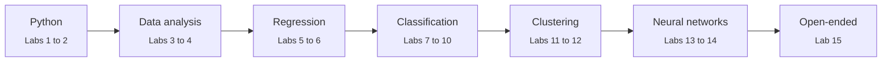

<div align="center">

# Machine Learning Lab

**CS-3105 · Lab work, notebooks and reports**


*From `print()` to a neural network that reads handwriting, one lab at a time.*

</div>

<br>

| | |
|---|---|
| **Student** | [Shahzad Ahmed Awan](https://github.com/ShahzadAhmedAwan) |
| **Roll No** | 2024-SE-15 |
| **Course** | CS-3105 Machine Learning Lab |
| **Instructor** | Engr. Muhammad Awais |

---

## About this repository

This repository holds my work for the Machine Learning Lab course: one notebook per lab, with each task in its own cell and every output visible and labelled. Each lab lives in its own folder with a short README covering the tasks, how to run it and the notes behind the solutions.

The course follows the standard machine learning workflow: learn the tools, understand the data, then build and judge models.

## Course roadmap



## Learning outcomes

| CLO | Statement | Level | PLO | Labs |
|:-:|---|:-:|---|:-:|
| **5** | Use Python programming and tools to perform data handling and basic operations | C-3 Apply | PLO 5, Modern Tool Usage | 1 to 2 |
| **6** | Analyze real-world datasets by applying data manipulation and visualization techniques | C-4 Analyze | PLO 2, Problem Analysis | 3 to 4 |
| **7** | Apply machine learning algorithms and assess their performance using appropriate evaluation metrics | C-3 Apply | PLO 4, Investigation | 5 to 15 |

## Labs

| Lab | Topic | CLO | Status |
|:-:|---|:-:|:-:|
| [01](./Lab-01-Python-Basics) | Introduction to Python programming | 5 | Complete |
| 02 | NumPy: arrays and vectorised math | 5 | Upcoming |
| 03 | Pandas: loading, cleaning and exploring tables | 6 | Upcoming |
| 04 | Matplotlib and Seaborn: visualisation | 6 | Upcoming |
| 05 | Simple linear regression | 7 | Upcoming |
| 06 | Multiple linear regression | 7 | Upcoming |
| 07 | Logistic regression | 7 | Upcoming |
| 08 | K-Nearest Neighbours (KNN) | 7 | Upcoming |
| 09 | ID3 decision tree | 7 | Upcoming |
| 10 | Naive Bayes | 7 | Upcoming |
| 11 | K-Means clustering | 7 | Upcoming |
| 12 | DBSCAN | 7 | Upcoming |
| 13 | Single-layer perceptron | 7 | Upcoming |
| 14 | Multi-layer perceptron | 7 | Upcoming |
| 15 | Open-ended: classify handwritten digits | 7 | Upcoming |

## Tech stack

| Layer | Tools | Used from |
|---|---|---|
| Language | Python 3.9+ | Lab 1 |
| Numerical computing | NumPy | Lab 2 |
| Data handling | Pandas | Lab 3 |
| Visualisation | Matplotlib, Seaborn | Lab 4 |
| Machine learning | scikit-learn | Labs 5 to 15 |
| Environment | Jupyter Notebook, Google Colab, VS Code | All labs |

## Repository structure

```text
.
├── Lab-01-Python-Basics/
│   ├── Lab01_2024-SE-15_ShahzadAhmedAwan.ipynb
│   ├── ML_Lab01_FINAL.html
│   └── README.md
├── Lab-02-.../              # added as each lab is completed
├── ...
└── README.md                # this file
```

## Running a lab

<details open>
<summary><b>Google Colab</b> (recommended, nothing to install)</summary>

<br>

1. Open [colab.research.google.com](https://colab.research.google.com) and sign in.
2. Choose **File → Upload notebook** and select the lab's `.ipynb` file.
3. Run **Runtime → Restart and run all**.

</details>

<details>
<summary><b>Run locally</b></summary>

<br>

```bash
git clone https://github.com/ShahzadAhmedAwan/<repository-name>.git
cd <repository-name>
pip install notebook numpy pandas matplotlib seaborn scikit-learn
jupyter notebook
```

Open the lab's notebook and choose **Kernel → Restart & Run All**.

</details>

## Conventions

- One notebook per lab, named `LabNN_RollNo_Name.ipynb`
- A text cell above every code cell with the task number, question, approach and expected result
- Every output labelled, for example `print("Q1:", ...)`
- Each notebook is run with **Restart and run all** before it is committed
- Every line of code is my own work and I can explain it

---

<div align="center">

**Shahzad Ahmed Awan** ·
[GitHub: @ShahzadAhmedAwan](https://github.com/ShahzadAhmedAwan)

</div>
